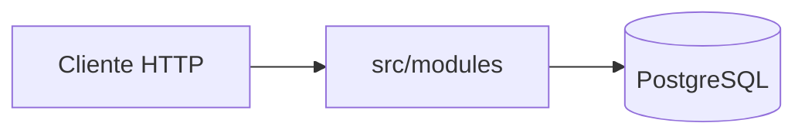

# cocos-api-challenge

API NestJS para consultar la cuenta de un inversor, buscar activos y enviar órdenes al mercado (MARKET y LIMIT). Los precios están en pesos; no se simula el libro de ofertas.

**Enunciado oficial del challenge:** [docs/backend-challenge.md](docs/backend-challenge.md).

Esta entrega interpreta ese texto en [docs/prd.md](docs/prd.md) y lo implementa según [docs/rfc.md](docs/rfc.md) (headers `x-user-id` e `Idempotency-Key`, tabla aditiva de idempotencia, correlación, logs canónicos, etc.). Para probar el producto paso a paso y leer los logs, ver [docs/guia-del-challenge.md](docs/guia-del-challenge.md).

## Requisitos

- Node.js **26** (ver `engines` en [package.json](package.json))
- PostgreSQL accesible vía `DATABASE_URL` (local, Neon u otro remoto con red saliente)

## Levantar el proyecto (recomendado — npm)

```bash
cp .env.example .env
# Ajustar DATABASE_URL (local, host.docker.internal si la API va en Docker, o Neon)
npm ci
npm run build
npm run db:bootstrap   # base vacía: seed del challenge + migraciones
npm run start:dev
```

Si la base **ya tiene** el esquema y datos del challenge pero **falta** la migración aditiva:

```bash
npm run build
npm run migration:run
npm run start:dev
```

`db:bootstrap` no recarga el seed si existe `public.users`; siempre aplica migraciones pendientes. Sin la migración, faltan `pg_trgm`, índices y `order_idempotency_keys`.

Nest carga variables desde `.env` en la raíz (`@nestjs/config`).

### Reset de la base (local)

Con `DATABASE_URL` apuntando a Postgres **local** (`localhost`, `127.0.0.1` o `host.docker.internal`):

```bash
npm run reset-database
```

Hace `DROP SCHEMA public`, `build`, seed y migraciones en un solo paso.

Si `.env` apunta a una base **remota** (Neon), el comando **aborta** sin tocar datos. Para forzar un reset remoto (solo entornos de prueba):

```bash
DB_RESET_ALLOW_REMOTE=true npm run reset-database
```

O en `.env`: `DB_RESET_ALLOW_REMOTE=true` (ver [.env.example](.env.example)).

### Producción (Neon u otro remoto)

La base la provee el challenge; **no** uses `db:bootstrap` contra prod (no vuelve a insertar el seed). Primera vez o deploy nuevo:

```bash
npm run build && npm run migration:run
```

`DATABASE_URL` con `sslmode=require` (y parámetros que pida el proveedor) va en `.env` o en secretos de CI — **nunca** en el repositorio.

## Docker (alternativa — CI/CD o imagen)

El compose **solo** construye y corre la API. Postgres **no** va en el repo: la URL sale de `.env` (`env_file`). El contenedor necesita **salida a Internet** si la base es remota (Neon).

```bash
cp .env.example .env
# Editar DATABASE_URL antes de levantar
docker compose up --build
```

O manual:

```bash
docker build -t cocos-api .
docker run --rm --env-file .env -p 3000:3000 cocos-api
```

| Variable | Uso |
| --- | --- |
| `DATABASE_URL` | Obligatoria. Local, `host.docker.internal` (Postgres en el host) o Neon. |
| `RUN_MIGRATIONS` | Default `true`: al arrancar el contenedor corre migraciones **pendientes** (idempotente). `false` si migrás en un job aparte. |

Migrar sin levantar HTTP:

```bash
docker run --rm --env-file .env cocos-api node dist/database/cli/run-migrations.js
```

Flujo CI/CD típico: job de migración con el mismo imagen, luego deploy con `RUN_MIGRATIONS=false`.

## Migraciones

| Comando | Uso |
| --- | --- |
| `npm run migration:run` | Aplica migraciones pendientes. Correr después de `build`. |
| `npm run migration:revert` | Revierte la última migración. |

En el contenedor, con `RUN_MIGRATIONS=true` (default), el arranque hace lo mismo que `migration:run`. Detalle del DDL: [docs/rfc.md](docs/rfc.md) §5.

## Documentación HTTP

Con `PORT=3000` (default):

| Recurso | URL |
| --- | --- |
| Swagger UI | http://localhost:3000/swagger |
| OpenAPI JSON | http://localhost:3000/schema.json |
| Health | http://localhost:3000/health |

## Colección Postman

Importar [docs/API Cocos Challenge - Gonzalo Rosinski.postman_collection.json](docs/API%20Cocos%20Challenge%20-%20Gonzalo%20Rosinski.postman_collection.json) y definir `baseUrl` = `http://localhost:3000`. Los escenarios esperados están en [docs/escenarios-de-prueba.md](docs/escenarios-de-prueba.md). Curls equivalentes: [docs/curls.md](docs/curls.md).

## Estructura del proyecto

Monolito modular NestJS, un proceso, capas por módulo. El flujo HTTP entra por controladores, orquesta servicios y persiste vía repositorios que implementan **ports**.



| Ruta | Rol |
| --- | --- |
| [src/modules/](src/modules/) | `users`, `portfolio`, `instruments`, `orders`, `health` |
| [src/common/](src/common/) | Middleware, correlación, log canónico, errores HTTP |
| [src/config/](src/config/) | `DATABASE_URL`, `PORT` |
| [src/database/](src/database/) | TypeORM, migraciones, `db:bootstrap`, CLI |
| [src/domain/](src/domain/) | Dominio compartido: ledger, money, tipos de orden |
| [src/observability/](src/observability/) | OpenTelemetry |
| [src/openapi/](src/openapi/) | Swagger |
| [database/seed.sql](database/seed.sql) | Datos del challenge (bootstrap / psql) |
| [docs/](docs/) | Enunciado, PRD, RFC, guías y Postman |

Plantilla de un módulo con negocio (`portfolio`, `instruments`, `orders`):

```
src/modules/<nombre>/
├── application/    # dto, ports, services
├── domain/         # reglas, entities, validators (orders: state machine)
├── infrastructure/ # mappers, *.repository.ts
├── <nombre>.controller.ts
└── <nombre>.module.ts
```

- El **controlador** traduce HTTP; el **servicio** es el caso de uso; el **repositorio** cumple el port (TypeORM no entra al servicio).
- `users`: lookup de cuenta y lock pessimista; sin endpoints propios.
- `health`: solo DTO, controller y module (sin dominio ni infra).
- Imports con alias `@/` → `src/`, ESM; tests con Vitest.

Diseño por feature (diagramas): [docs/portfolio.md](docs/portfolio.md), [docs/instruments.md](docs/instruments.md), [docs/orders.md](docs/orders.md).

## Más documentación

Índice completo: [docs/README.md](docs/README.md).

## Pruebas

```bash
npm test
npm run test:integration   # envío de órdenes contra PostgreSQL (DATABASE_URL en .env)
npm run test:cov
```
