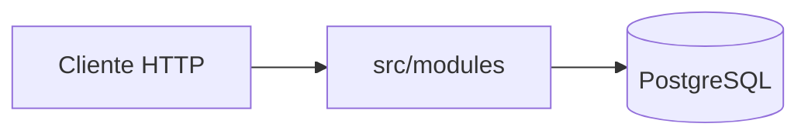

# cocos-api-challenge

API NestJS para consultar la cuenta de un inversor, buscar activos y enviar órdenes al mercado (MARKET y LIMIT). Los precios están en pesos; no se simula el libro de ofertas.

**Enunciado oficial del challenge:** [docs/backend-challenge.md](docs/backend-challenge.md).

Esta entrega interpreta ese texto en [docs/prd.md](docs/prd.md) y lo implementa según [docs/rfc.md](docs/rfc.md) (headers `x-user-id` e `Idempotency-Key`, tabla aditiva de idempotencia, correlación, logs canónicos, etc.). Para probar el producto paso a paso y leer los logs, ver [docs/guia-del-challenge.md](docs/guia-del-challenge.md).

## Requisitos

- Node.js **26** (ver `engines` en [package.json](package.json))
- PostgreSQL **16**, o Docker Compose

## Levantar el proyecto

### Opción A — Docker (recomendada)

```bash
docker compose up --build
```

- Postgres monta [database/seed.sql](database/seed.sql) en el primer arranque.
- La imagen de la API ejecuta las migraciones y después inicia Nest ([Dockerfile](Dockerfile)).

### Opción B — API en el host

```bash
cp .env.example .env
# Ajustar DATABASE_URL si hace falta (por defecto localhost:5432/neondb)
docker compose up postgres -d   # u otro Postgres con el seed
npm ci
npm run build
npm run db:bootstrap            # solo si la base está vacía
npm run migration:run           # obligatorio en host
npm run start:dev
```

Sin `migration:run`, faltan los índices de búsqueda (`pg_trgm`) y la tabla `order_idempotency_keys`: la búsqueda y la idempotencia de órdenes no funcionan como en el RFC.

Nest carga variables desde `.env` en la raíz (`@nestjs/config`).

## Migraciones

| Comando | Uso |
| --- | --- |
| `npm run migration:run` | Aplica migraciones (índices + idempotencia). Correr después de `build`. |
| `npm run migration:revert` | Revierte la última migración. |

En Docker, el arranque ya ejecuta `migration:run`. Detalle del DDL: [docs/rfc.md](docs/rfc.md) §5.

## Documentación HTTP

Con `PORT=3000` (default):

| Recurso | URL |
| --- | --- |
| Swagger UI | http://localhost:3000/swagger |
| OpenAPI JSON | http://localhost:3000/schema.json |
| Health | http://localhost:3000/health |

## Colección Postman

Importar [docs/API Cocos Challenge - Gonzalo Rosinski.postman_collection.json](docs/API%20Cocos%20Challenge%20-%20Gonzalo%20Rosinski.postman_collection.json) y definir `baseUrl` = `http://localhost:3000`. Los escenarios esperados están en [docs/escenarios-de-prueba.md](docs/escenarios-de-prueba.md). Curls equivalentes: [docs/curls.md](docs/curls.md).

## Estructura del proyecto

Monolito modular NestJS, un proceso, capas por módulo. El flujo HTTP entra por controladores, orquesta servicios y persiste vía repositorios que implementan **ports**.



| Ruta | Rol |
| --- | --- |
| [src/modules/](src/modules/) | `users`, `portfolio`, `instruments`, `orders`, `health` |
| [src/common/](src/common/) | Middleware, correlación, log canónico, errores HTTP |
| [src/config/](src/config/) | `DATABASE_URL`, `PORT` |
| [src/database/](src/database/) | TypeORM, migraciones, `db:bootstrap`, CLI |
| [src/domain/](src/domain/) | Dominio compartido: ledger, money, tipos de orden |
| [src/observability/](src/observability/) | OpenTelemetry |
| [src/openapi/](src/openapi/) | Swagger |
| [database/seed.sql](database/seed.sql) | Datos del challenge |
| [docs/](docs/) | Enunciado, PRD, RFC, guías y Postman |

Plantilla de un módulo con negocio (`portfolio`, `instruments`, `orders`):

```
src/modules/<nombre>/
├── application/    # dto, ports, services
├── domain/         # reglas, entities, validators (orders: state machine)
├── infrastructure/ # mappers, *.repository.ts
├── <nombre>.controller.ts
└── <nombre>.module.ts
```

- El **controlador** traduce HTTP; el **servicio** es el caso de uso; el **repositorio** cumple el port (TypeORM no entra al servicio).
- `users`: lookup de cuenta y lock pessimista; sin endpoints propios.
- `health`: solo DTO, controller y module (sin dominio ni infra).
- Imports con alias `@/` → `src/`, ESM; tests con Vitest.

Diseño por feature (diagramas): [docs/portfolio.md](docs/portfolio.md), [docs/instruments.md](docs/instruments.md), [docs/orders.md](docs/orders.md).

## Más documentación

Índice completo: [docs/README.md](docs/README.md).

## Pruebas

```bash
npm test
npm run test:integration   # envío de órdenes contra PostgreSQL
npm run test:cov
```
