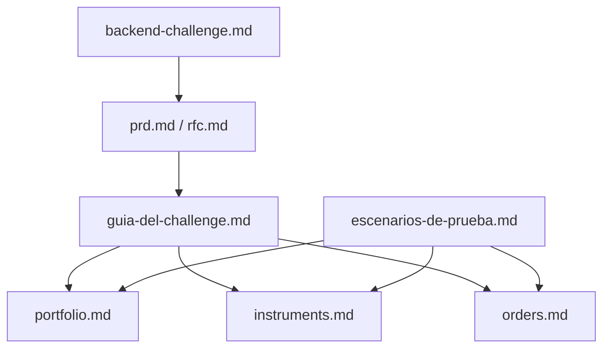

# Documentación — API Cocos Challenge

Ante una duda sobre **qué pedía el challenge**, mirá el [enunciado original](backend-challenge.md). La **interpretación de producto** está en [prd.md](prd.md). El **comportamiento HTTP implementado** (contratos, errores, logs, escenarios E2E) está en [rfc.md](rfc.md).

## Mapa

## Por rol

| Si querés… | Documento |
| --- | --- |
| Leer el pedido del proveedor | [backend-challenge.md](backend-challenge.md) |
| Arrancar la API y migraciones | [../README.md](../README.md) |
| Demo, correlación y logs por feature | [guia-del-challenge.md](guia-del-challenge.md) |
| Tabla Postman ↔ respuestas esperadas | [escenarios-de-prueba.md](escenarios-de-prueba.md) |
| Cómo se calcula la cuenta | [portfolio.md](portfolio.md) |
| Cómo funciona la búsqueda | [instruments.md](instruments.md) |
| Órdenes, idempotencia, concurrencia, XState | [orders.md](orders.md) |
| Curls copiables | [curls.md](curls.md) |
| Colección Postman | [API Cocos Challenge - Gonzalo Rosinski.postman_collection.json](API%20Cocos%20Challenge%20-%20Gonzalo%20Rosinski.postman_collection.json) |
| Plan de implementación (tickets) | [tickets/README.md](tickets/README.md) |

## Cambios respecto al enunciado

El [PRD](prd.md) y el [RFC](rfc.md) documentan extensiones que no figuran en el texto del challenge:

- Identificación de cuenta por header `x-user-id` (sin login).
- `Idempotency-Key` (UUID) en `POST /orders` y tabla `order_idempotency_keys`.
- Índices `pg_trgm` para búsqueda por ticker/nombre.
- Correlación (`x-correlation-id`), log canónico JSON y spans OpenTelemetry.
- Sin endpoint de cancelación de órdenes (`CANCELLED` solo impacta el cálculo desde datos del seed).

Justificación de cambios de esquema: [rfc.md](rfc.md) §5.
