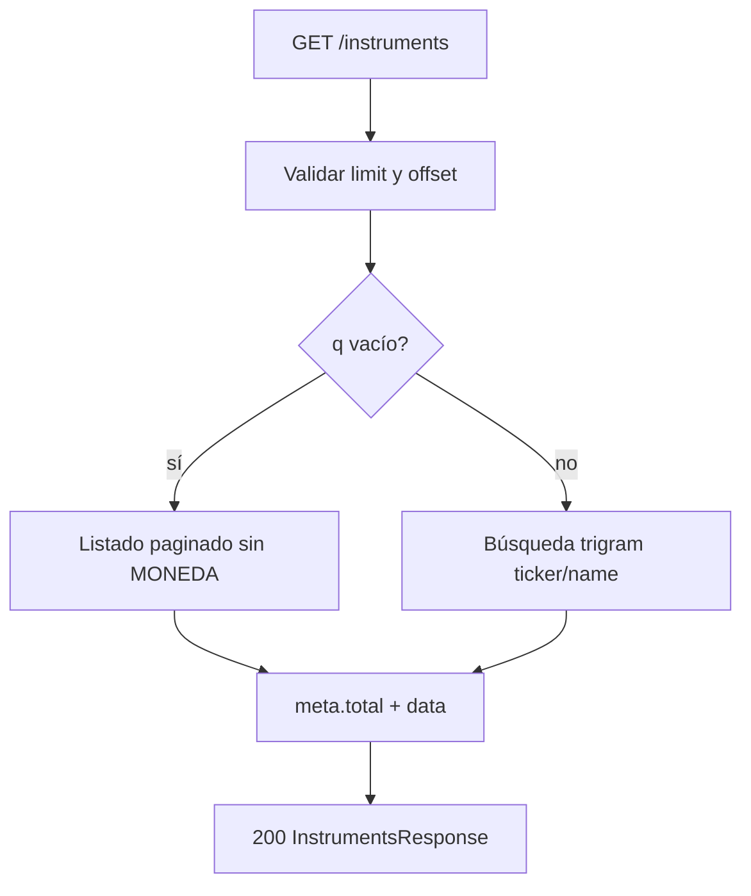
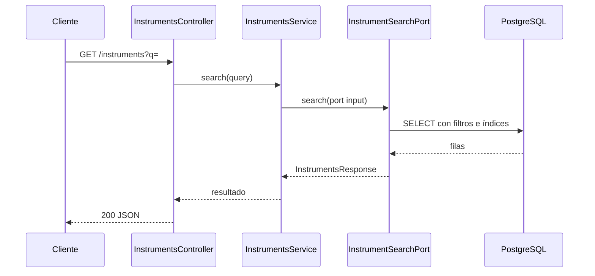

# Instruments — búsqueda de activos

`GET /instruments` lista o busca instrumentos del mercado por ticker o nombre (sin distinguir mayúsculas). La moneda (ARS, tipo `MONEDA`) **no** aparece en resultados.

Relacionado: [enunciado](backend-challenge.md), [escenarios-de-prueba.md](escenarios-de-prueba.md), migración con índices GIN en [rfc.md](rfc.md) §5.

## Contrato

Query params:

| Param | Default | Descripción |
| --- | --- | --- |
| `q` | `""` | Subcadena de ticker o nombre |
| `limit` | 10 | Tamaño de página |
| `offset` | 0 | Desplazamiento |

Respuesta: `data[]` + `meta` (`total`, `limit`, `offset`). No requiere `x-user-id`.

## Reglas

- `q` vacío → catálogo completo paginado (orden por ticker).
- `q` con texto → filtro por similitud (índices `pg_trgm` en ticker y name).
- Coincidencias que solo aplican a la moneda → lista vacía.

## Capas

| Capa | Responsabilidad |
| --- | --- |
| `InstrumentsController` | Query string, validación |
| `InstrumentsService` | Normaliza `q` a minúsculas y delega |
| `InstrumentSearchPort` / repository | SQL TypeORM con exclusión de `MONEDA` |

## Diagrama de flujo

## Diagrama de secuencia

## Base de datos

Migración [1731340800000-add-search-indexes-and-idempotency.ts](../src/database/migrations/1731340800000-add-search-indexes-and-idempotency.ts):

- `CREATE EXTENSION pg_trgm`
- Índices GIN `instruments_ticker_trgm`, `instruments_name_trgm`

## Observabilidad

Log canónico con texto de búsqueda y paginación; sin `userId`. Ver [guia-del-challenge.md](guia-del-challenge.md).
