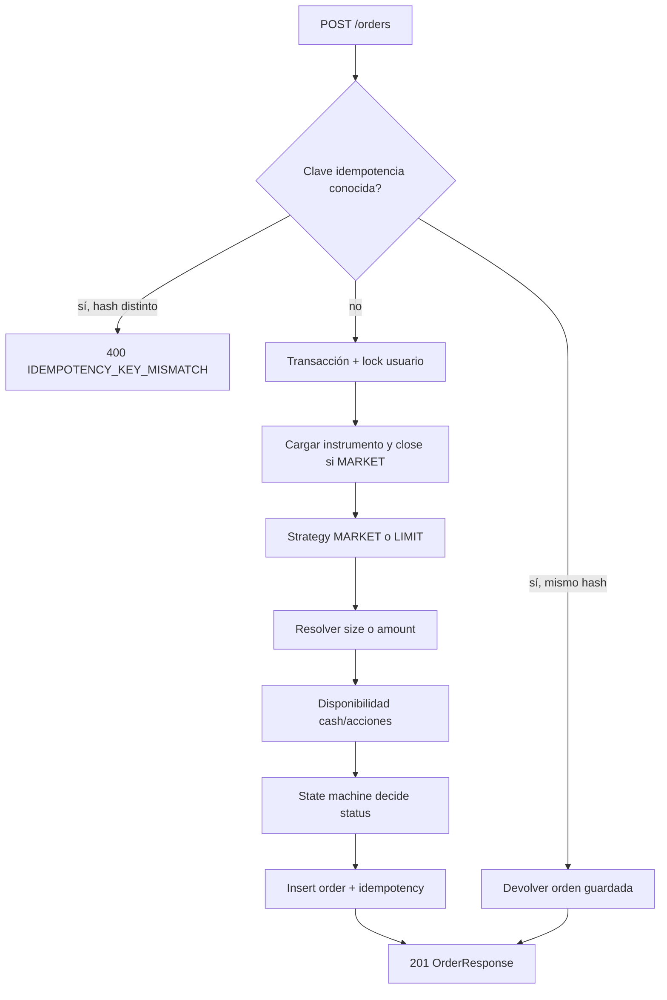
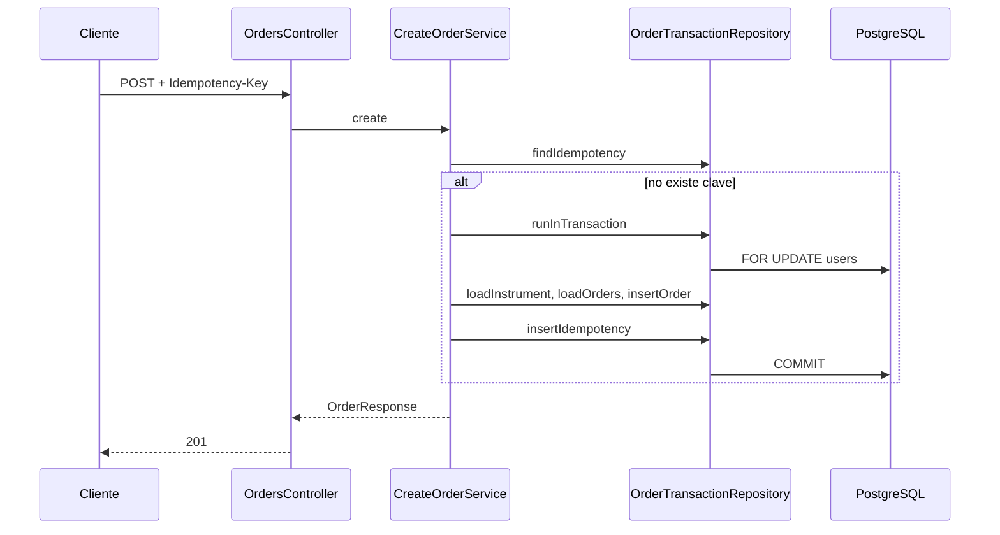
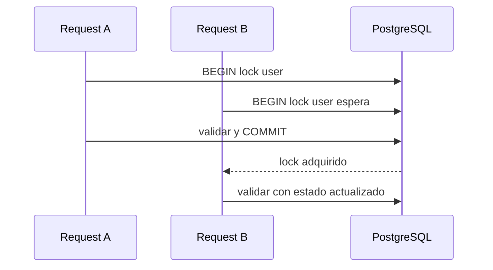
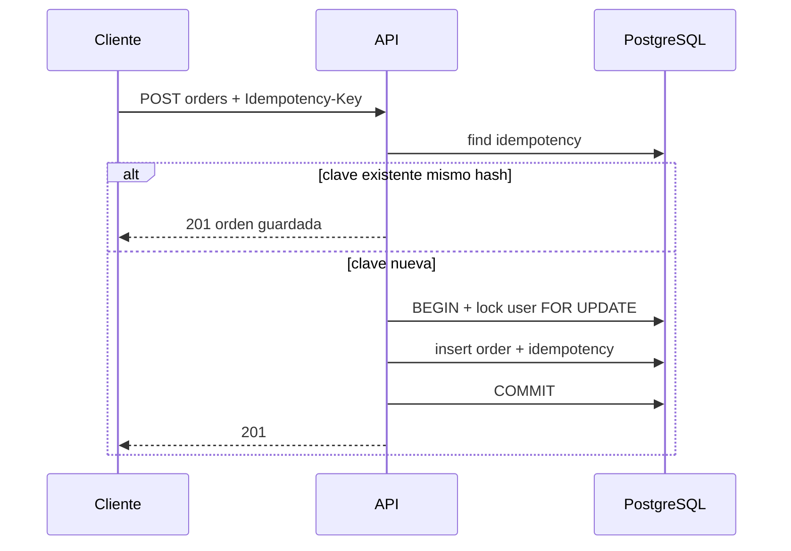

# Orders — alta, estado, concurrencia e idempotencia

`POST /orders` registra una compra o venta **MARKET** o **LIMIT**. El estado resultante puede ser `FILLED`, `NEW` o `REJECTED`. Una rechazada por falta de pesos o acciones sigue siendo **HTTP 201** con `status: REJECTED` ([rfc.md](rfc.md) §8).

Headers: `x-user-id`, `Idempotency-Key` (UUID), `Content-Type: application/json`.

Relacionado: [escenarios-de-prueba.md](escenarios-de-prueba.md), máquina importable en [diagrams/order-machine.machine.json](diagrams/order-machine.machine.json).

## Pipeline

## Diagrama de secuencia (alta nueva)

## State pattern en código

| Tipo | Strategy | Estado (`OrderState`) | Si aceptada | Si rechazada |
| --- | --- | --- | --- | --- |
| MARKET | `MarketOrderStrategy` | `FilledOrderState` | `FILLED` | `REJECTED` |
| LIMIT | `LimitOrderStrategy` | `NewOrderState` | `NEW` | `REJECTED` |

La aceptación usa `isOrderAccepted` ([order-acceptance.ts](../src/modules/orders/domain/validators/order-acceptance.ts)): cash suficiente en compras, acciones en ventas, `size` entero ≥ 1.

`CANCELLED` existe en el seed pero esta API **no** expone transiciones de cancelación; solo afecta lecturas históricas del portfolio.

## Máquina de estados (XState)

El runtime no usa la librería XState; usa **State pattern** (`domain/states/`). Para visualizar la decisión de estado al enviar una orden, importá el archivo en [Stately Viz](https://stately.ai/viz):

**[diagrams/order-machine.machine.json](diagrams/order-machine.machine.json)**

Eventos modelados:

- `PLACE_MARKET` → `filled` u `rejected` según guard `orderAccepted`
- `PLACE_LIMIT` → `new` u `rejected` según el mismo guard

## Concurrencia

Dos requests simultáneas del mismo usuario pueden competir por el mismo saldo o tenencia. Mitigación:

1. **Lock pessimista** de la fila `users` al inicio de la transacción de alta (`pessimistic_write` en [order-transaction.repository.ts](../src/modules/orders/infrastructure/repositories/order-transaction.repository.ts)).
2. Las validaciones de disponibilidad leen el historial de órdenes **dentro** de esa transacción, de modo que dos altas en paralelo se serializan por usuario.

## Idempotencia

| Paso | Comportamiento |
| --- | --- |
| Hash del cuerpo | SHA-256 de JSON canónico ([canonical-order-payload.ts](../src/modules/orders/domain/canonical-order-payload.ts)) |
| Primera request | Insert en `orders` + fila en `order_idempotency_keys` |
| Replay | Misma `(user_id, idempotency_key)` y mismo `payload_hash` → respuesta guardada, sin nuevo insert |
| Misma clave, otro cuerpo | `400` `IDEMPOTENCY_KEY_MISMATCH` |
| Carrera en insert | `UNIQUE (user_id, idempotency_key)` → `IdempotencyConflictError` → relectura y replay o mismatch |

Tabla creada en migración: `order_idempotency_keys` ([rfc.md](rfc.md) §5).

## Tamaño y precio

- **MARKET:** precio = último `close`; no se envía `price` en el body.
- **LIMIT:** `price` obligatorio.
- **Monto en pesos:** campo `amount` → `size = floor(amount / price)` sin fracciones ([resolve-order-size.ts](../src/modules/orders/domain/resolve-order-size.ts)).

## Observabilidad

En [create-order.service.ts](../src/modules/orders/application/services/create-order.service.ts):

1. `order_received` (correlationId, userId, instrumento, lado, tipo, size/amount)
2. `order_validated` (resultado: `FILLED`, `NEW`, `REJECTED`, `REPLAY` o código de error)
3. Log canónico HTTP con contexto de orden

Spans: `orderSide`, `orderType`, `orderStatus` al cerrar la request. Ver [guia-del-challenge.md](guia-del-challenge.md).

## Pruebas

- Unitarias: state machine, strategies, idempotencia, canonical payload.
- Integración: `npm run test:integration` contra PostgreSQL con los cinco casos del RFC req. 18.
