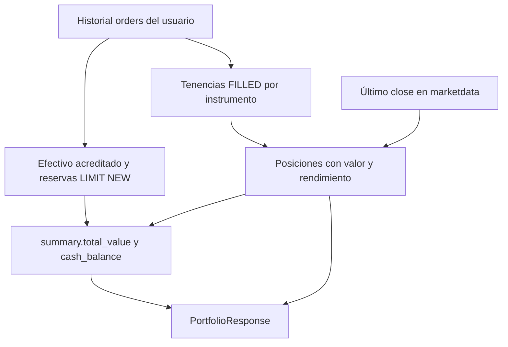
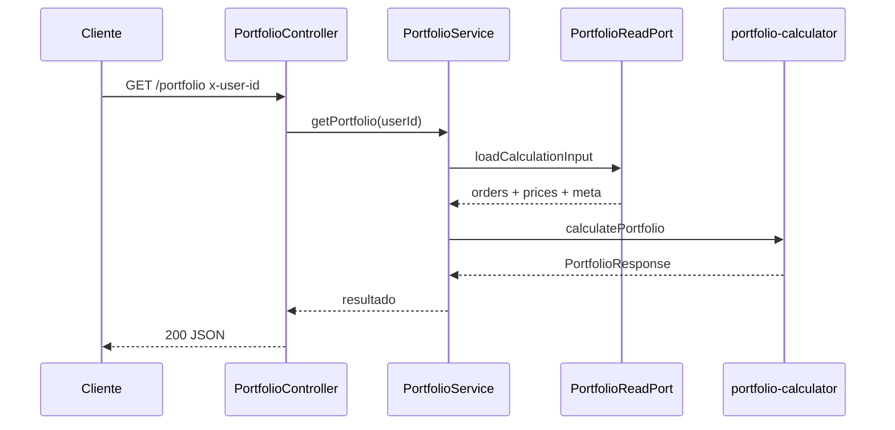

# Portfolio — diseño y flujo

`GET /portfolio` devuelve el **agregado de cuenta**: valor total, pesos disponibles para operar y posiciones con cantidad, valor de mercado y rendimiento total (%). No hay tabla de posiciones; el resultado se calcula desde `orders` y el último precio en `marketdata`.

Relacionado: [enunciado](backend-challenge.md), [prd.md](prd.md) (historia “Ver la cuenta”), [escenarios-de-prueba.md](escenarios-de-prueba.md).

## Reglas de negocio

- **Movimientos de cash:** órdenes `CASH_IN` / `CASH_OUT` y efecto de compras/ventas `FILLED`.
- **Tenencia:** solo `FILLED` en activos operables; `REJECTED` y `CANCELLED` no mueven cash ni acciones.
- **Órdenes límite `NEW`:** una compra aparta pesos (`openBuyReserve`); una venta aparta acciones. Impactan `cash_balance` pero no crean posición `FILLED` nueva.
- **Sin tenencias negativas:** posiciones en cero no se listan; datos del seed con tenencia negativa en BMA no se exponen.
- **Precio de mercado:** último `close` por instrumento; moneda ARS no es posición.
- **Rendimiento total:** valor de mercado vs costo promedio ponderado de compras `FILLED`.

Implementación principal: [portfolio-calculator.ts](../src/modules/portfolio/domain/portfolio-calculator.ts) y ledger en [src/domain/ledger/](../src/domain/ledger/).

## Capas

| Capa | Responsabilidad |
| --- | --- |
| `PortfolioController` | `x-user-id`, HTTP 200 |
| `PortfolioService` | Orquesta lectura + cálculo |
| `PortfolioReadPort` / repository | Carga órdenes, precios, instrumentos |
| `calculatePortfolio` | Dominio puro |

## Diagrama de flujo (cálculo)

## Diagrama de secuencia

## Errores

| Situación | HTTP | Código |
| --- | --- | --- |
| Sin `x-user-id` o no entero | 400 | `INVALID_USER_ID` |
| Usuario inexistente | 404 | `USER_NOT_FOUND` |

## Observabilidad

Un log canónico al finalizar con `userId` en `context`. Ver [guia-del-challenge.md](guia-del-challenge.md).
