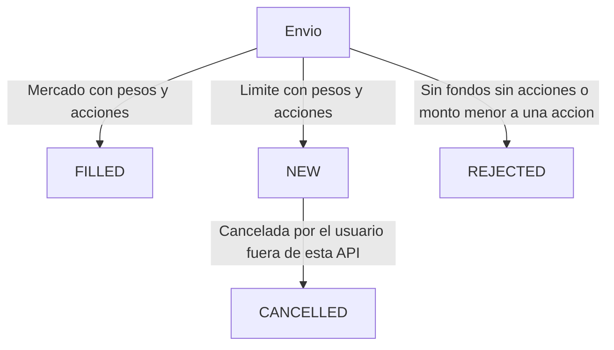

# RFC — Arquitectura de la API

| | |
| --- | --- |
| Autor | Gonzalo Matias Peredo Rosinski |
| Estado | El framework es NestJS, en un monolito modular. TypeORM es el acceso a datos. La concurrencia de la orden usa bloqueo pesimista de la fila de la cuenta. |
| Relación | Parte del [PRD](prd.md) aprobado. El PRD dice qué hace el inversor. Este RFC dice qué exige eso a la arquitectura. |

Dos refinamientos respecto del PRD, que este RFC cierra:

- La cuenta de ver el portfolio y la de enviar una orden viajan en el header `x-user-id`, no en la ruta ni en el cuerpo.
- La búsqueda de activos responde de a páginas, con 10 resultados por defecto.

## 1. Requerimientos

### Del producto

1. La API ofrece tres servicios: ver la cuenta, buscar un activo y enviar una orden.
2. La cuenta se arma al consultarla. No hay una lista de posiciones guardada. Los pesos y las tenencias salen de los movimientos ya registrados y del último cierre de cada activo.
3. Los pesos disponibles restan el dinero apartado por compras límite abiertas. El valor total de la cuenta no resta ese apartado: el dinero sigue en la cuenta.
4. Una venta límite abierta aparta esas acciones.
5. Una orden que pide más pesos o más acciones de los disponibles se guarda como rechazada. Una venta que dejaría la tenencia por debajo de cero también se rechaza. La cuenta no muestra tenencias en cero ni negativas.
6. Una orden a mercado se ejecuta en el momento al último cierre. Una orden límite queda abierta al precio elegido por el inversor.
7. Si el inversor indica un monto en pesos, la orden usa la mayor cantidad entera de acciones que ese monto alcanza.
8. La búsqueda encuentra por ticker o por nombre, con una parte del texto y sin distinguir mayúsculas. Los pesos no aparecen como activo ni como posición. La página trae como máximo 10 activos, salvo que la llamada pida otro `limit`.
9. Una orden rechazada o cancelada no mueve la cuenta. No hay un servicio para cancelar.
10. No hay autenticación. Ver la cuenta y enviar una orden indican la cuenta en `x-user-id`. Buscar un activo no pide cuenta.
11. No se simula el mercado ni se ejecuta después una orden límite que quedó abierta.
12. La cuenta de Emiliano, descrita en el PRD, es la verificación del servicio de cuenta.

### De la entrega

13. La aplicación corre en Node.js, en la versión LTS activa al implementar.
14. La interfaz es una API REST. El enunciado nombra Express y NestJS como ejemplos, no como obligación.
15. El acceso a datos es TypeORM, sobre el esquema de PostgreSQL ya provisto. No se renombran columnas. El cierre vive en `marketdata.date`.
16. En desarrollo la base es local. En producción es remota. Las dos se eligen por configuración. El secreto no se versiona.
17. Se puede levantar el proceso en local para desarrollar, y también construir y correr la API con Docker.
18. Hay prueba unitaria de las reglas, de la máquina de estados, de cada servicio, del middleware de usuario y del mapeo de errores. La prueba de integración del envío de una orden corre contra PostgreSQL, con las mismas reglas que el servicio, y cubre el mismo comportamiento que los escenarios E2E de la sección 12.
19. Cada llamada deja un log canónico con `correlationId`. El envío de una orden, además, deja log al recibirla y al validarla. El log canónico de esa llamada es el resultado de la transacción.
20. Los logs y los atributos de monitoreo no incluyen datos de contacto. La sección 6 clasifica qué es PII.
21. La API queda preparada para monitoreo con atributos propios, para poder armar alertas después. New Relic queda descartado por costo.
22. Hay un Swagger con ejemplos que funcionan contra la base de ejemplo, y un `schema.json` que se puede importar en Postman.
23. Los errores de la llamada y los errores de las dependencias se traducen a excepciones. La respuesta de error de cliente y la de servidor tienen una forma fija.
24. El repositorio fija el formato, los commits y las reglas de Cursor desde el primer día. El detalle está en la sección 10.

## 2. Capacidades

| Capacidad | Qué tiene que lograr | La usa |
| --- | --- | --- |
| Publicar los tres servicios | Un solo proceso expone ver la cuenta, buscar un activo y enviar una orden. | Los tres |
| Identificar la cuenta | Un middleware lee `x-user-id` y confirma que esa cuenta existe antes de entrar al servicio. | Ver la cuenta, enviar una orden |
| Armar la cuenta en la consulta | Calcular valor total, pesos disponibles y posiciones a partir de órdenes, reservas y el último cierre. Excluir tenencias que no sean positivas y excluir la moneda. | Ver la cuenta |
| Buscar instrumentos por página | Filtrar por una parte del ticker o del nombre, sin distinguir mayúsculas, dejar afuera la moneda y devolver una página de 10. | Buscar un activo |
| Decidir una orden | Una máquina de estados resuelve el estado final: ejecutada, abierta o rechazada. | Enviar una orden |
| Comprometer una sola vez | La decisión y el guardado ocurren en una transacción con commit por cuenta. | Enviar una orden |
| Conservar el esquema dado | Leer y escribir las tablas provistas. Los índices nuevos se justifican en la sección 5 y no cambian el modelo. | Las tres de datos |
| Elegir la base por entorno | La misma aplicación apunta a Postgres local o remoto cambiando la configuración. | Todas |
| Dejar rastro de la llamada | Log canónico por request, con `correlationId`. En una orden, también al recibir y al validar. | Todas |
| Traducir errores | Una excepción de entrada o de dominio responde como error de cliente. Una falla de dependencia responde como error de servidor. | Todas |
| Documentar la API | Swagger y `schema.json` con ejemplos válidos para la base de ejemplo. | Las tres |
| Observar sin fijar un vendor | Atributos propios listos para alertas, exportables más adelante. Sin New Relic. | Todas |
| Correr en local y en Docker | Desarrollo con el proceso de Node. Entrega con una imagen Docker. | Todas |
| Probar | Unitarias de todo lo nombrado en el requerimiento 18, y la prueba de integración del envío contra PostgreSQL, alineada con los escenarios E2E. | Enviar una orden, y el resto en unitarias |

Queda prevista, y no entra en esta entrega, una caché Redis delante de la búsqueda por texto. El diseño está en la sección de caché. El servicio de búsqueda tiene que poder recibirla después sin cambiar el contrato.

## 3. Qué le pide esto a la arquitectura

- Un solo desplegable. Son tres servicios de la misma cuenta, no tres sistemas.
- Un middleware delante de ver la cuenta y de enviar una orden.
- Las reglas y la máquina de estados separadas del transporte, para poder probarlas sin el servidor.
- TypeORM para hablar con PostgreSQL, con una transacción explícita y commit al crear la orden.
- Consultas que agreguen movimientos y precios. Ver la cuenta no es un alta de un registro.
- Un índice que sirva a la búsqueda parcial, otro a las órdenes por instrumento y tipo, y otro al último cierre por instrumento.
- Un log canónico al cerrar cada llamada, y dos logs de negocio en el envío de la orden.
- Un solo lugar que convierta excepciones en la respuesta de cliente o en la de servidor.
- OpenTelemetry, o el mismo tipo de atributos, sin enviarlos a New Relic.
- Swagger generado desde los tres servicios.
- Dockerfile para el build, y un modo local sin contenedor para desarrollar.
- La búsqueda aislada de forma que Redis pueda entrar después.

Con eso, el diseño que encaja es un monolito modular: un módulo por servicio, el middleware y el mapeo de errores en el borde, y la máquina de estados en el dominio de órdenes.

## 4. Qué aplica y qué no

### Arquitecturas que aplican

- Monolito modular, un proceso, tres módulos, una base.
- Reglas y máquina de estados detrás del HTTP.
- Cuenta calculada al leer.
- Alta de orden en una transacción con commit, tomando la cuenta para que dos envíos no se pisen.
- Caché opcional, más adelante, solo en la búsqueda de instrumentos.

### Frameworks HTTP que siguen en pie

Los tres pueden hacer middleware, TypeORM, Swagger, logs y una respuesta de error única. La diferencia es cuánto hay que armar a mano, y cuánto de eso se puede sacar después como otra API. La comparación está en la sección 13.

- NestJS. Módulos por servicio, middleware, filtro de excepciones, interceptor para el log canónico, módulo de TypeORM y módulo de Swagger.
- Express. Cumple si el proyecto arma esa misma estructura. El framework no la trae.
- Fastify. Cumple del mismo modo que Express. El enunciado no lo nombra y no lo excluye.

### Acceso a datos

TypeORM es la capa de acceso. SQL directo, Drizzle, Kysely y Prisma salen de la elección.

### Qué no aplica

- Partir los tres servicios en procesos separados, con colas o un broker.
- GraphQL u otro contrato que no sea REST.
- Una tabla de posiciones como fuente de la cuenta.
- Un servicio para cancelar, un proceso que simule el mercado o un servicio de autenticación.
- New Relic.
- Redis en esta entrega. Queda como extensión posible.
- Otra base que no sea PostgreSQL.

## 5. Índices

El esquema se usa como está. Se agregan índices, que el enunciado permite si están justificados.

| Consulta | Índice | Por qué |
| --- | --- | --- |
| Búsqueda por una parte del ticker o del nombre | GIN con `pg_trgm` sobre `instruments.ticker` y sobre `instruments.name` | Un índice btree no sirve cuando el texto buscado va en el medio o al final. |
| Órdenes de un instrumento según su tipo | `(instrumentId, type)` en `orders` | Es la búsqueda de órdenes por instrumento y tipo. |
| Último cierre de un instrumento | `(instrumentId, date)` en `marketdata` | El precio vigente es el cierre de la fecha más reciente de ese instrumento. |
| Movimientos de una cuenta al enviar una orden | `(userId, status)` en `orders` | La transacción lee los pesos y las acciones de esa cuenta. Sin este índice, el lock de la orden recorre la tabla. |
| Reintento de la misma orden | `uk_user_key` sobre `(user_id, idempotency_key)` en `order_idempotency_keys` | Dos reintentos iguales no pueden insertar dos claves de la misma cuenta. |

### Migración

NestJS no aplica estos cambios al arrancar. TypeORM, integrado con `@nestjs/typeorm`, corre una migración versionada contra la `DATABASE_URL` que se le indique. En producción es la base remota. `synchronize` queda apagado: la aplicación no altera el esquema por su cuenta.

La migración es aditiva. No recrea `users`, `instruments`, `orders` ni `marketdata`. El `CREATE TABLE` original no cita los identificadores, y PostgreSQL los guarda en minúsculas: `instrumentid`, `userid`. Los índices usan esos nombres.

`up` crea la extensión, los índices y la tabla de idempotencia. `down` los revierte. El índice GIN y el `CREATE EXTENSION` van escritos a mano. El generador de TypeORM no los deduce bien desde las entidades.

```sql
-- up
CREATE EXTENSION IF NOT EXISTS pg_trgm;

CREATE INDEX instruments_ticker_trgm
  ON instruments USING gin (ticker gin_trgm_ops);

CREATE INDEX instruments_name_trgm
  ON instruments USING gin (name gin_trgm_ops);

CREATE INDEX orders_instrument_type_idx
  ON orders (instrumentid, type);

CREATE INDEX orders_user_status_idx
  ON orders (userid, status);

CREATE INDEX marketdata_instrument_date_idx
  ON marketdata (instrumentid, date DESC);

CREATE TABLE order_idempotency_keys (
  id SERIAL PRIMARY KEY,
  user_id INT NOT NULL REFERENCES users(id),
  idempotency_key UUID NOT NULL,
  order_id INT NOT NULL REFERENCES orders(id),
  payload_hash VARCHAR(64) NOT NULL,
  created_at TIMESTAMP DEFAULT NOW(),
  CONSTRAINT uk_user_key UNIQUE (user_id, idempotency_key)
);
```

```sql
-- down
DROP TABLE IF EXISTS order_idempotency_keys;
DROP INDEX IF EXISTS marketdata_instrument_date_idx;
DROP INDEX IF EXISTS orders_user_status_idx;
DROP INDEX IF EXISTS orders_instrument_type_idx;
DROP INDEX IF EXISTS instruments_name_trgm;
DROP INDEX IF EXISTS instruments_ticker_trgm;
```

`down` no borra la extensión `pg_trgm`. Puede estar en uso fuera de esta API.

Se ejecuta una vez, antes de servir tráfico con el código nuevo: `migration:run` con la URL de esa base. En el contenedor, el arranque corre la migración y después levanta la API. Hace falta permiso para crear la extensión `pg_trgm`. Si el rol de producción no lo tiene, la extensión se habilita antes en el proveedor y la migración sigue con los índices y la tabla.

## 6. Logs, correlación y PII

Cada respuesta devuelve `x-correlation-id`. Si la llamada ya lo trae, se reutiliza. Si no, lo genera el servicio.

Tres momentos en el envío de una orden:

1. Recibida: `correlationId`, `userId`, instrumento, lado, tipo y la cantidad o el monto.
2. Validada: `correlationId` y el resultado de la validación.
3. Log canónico, al terminar la transacción: `correlationId`, ruta, estado HTTP, duración, `userId`, estado de la orden e id de la orden. Este registro es el resultado de la transacción, haya commit con orden ejecutada, abierta o rechazada, o haya rollback por una falla.

En el resto de las llamadas hay un solo log canónico, al finalizar, con `correlationId`, método, ruta, estado HTTP y duración. Ver la cuenta agrega `userId`. La búsqueda agrega el texto y la página, no una cuenta.

Cada handler puede fijar un título (por ejemplo `SearchInstruments`), un estado de negocio opcional para el mensaje (por ejemplo `FILLED`) y un objeto `context` con atributos acotados (`result_count`, `order_type`, `has_positions`). El mensaje legible sigue el formato `{title} [{status}] - {method} {path} -> {statusCode} {durationMs}ms`, omitiendo el corchete si no hay estado de negocio. El registro completo es una línea JSON con `message`, los campos operativos y `context`. `GET /health` no deja log canónico.

El nivel del log canónico depende del estado HTTP: por defecto `info`, `401` y `429` van con `warn`, y `500` o superior con `error`.

| Dato | Clasificación | En logs y atributos |
| --- | --- | --- |
| `email`, `accountNumber` | PII | No se escriben. |
| `userId` | Identificador interno | Sí. No alcanza para contactar a la persona. |
| `correlationId`, ruta, estado, duración | Operación | Sí. |
| Ticker, nombre del activo, precio, cantidad, lado, tipo, estado de la orden | Dato de mercado y de la orden | Sí. |
| Texto de búsqueda | Puede copiar un ticker o un nombre de activo | Sí. No es un dato de la persona. |

## 7. Monitoreo

La API instrumenta las llamadas con atributos propios: `correlationId`, ruta, estado HTTP, `userId` cuando existe, y en una orden el lado, el tipo y el estado resultante. Esos atributos son la base de alertas futuras.

No se envía nada a New Relic. El export queda preparado en OpenTelemetry, sin un backend pago elegido en esta entrega. Los atributos siguen la misma regla de PII que los logs.

Paquetes verificados en el runtime: `@opentelemetry/api` 1.10.0, `@opentelemetry/sdk-node` 0.301.1, `@opentelemetry/exporter-trace-otlp-http` 0.301.1, `@opentelemetry/resources` 3.1.1 y `@opentelemetry/semantic-conventions` 1.45.0. El SDK arranca en `start-tracing.ts` antes de Nest. Cada llamada (salvo `GET /health`) abre un span en `RequestSpanInterceptor` con `correlationId`, `route` y `httpStatus`; `userId` solo en rutas con cuenta; en `POST /orders` también `orderSide`, `orderType` y `orderStatus`. Si existe `OTEL_EXPORTER_OTLP_ENDPOINT`, se registra `OTLPTraceExporter`; si no, el SDK queda sin exportador y los spans no salen del proceso.

## 8. Errores

Una orden rechazada por falta de pesos, falta de acciones o monto menor a una acción no es un error HTTP. La transacción hace commit y la respuesta es 201 con la orden en `REJECTED`.

Todo lo demás entra por excepciones.

| Origen | Situación | Excepción | Respuesta |
| --- | --- | --- | --- |
| Inbound | Falta `x-user-id` o no es un entero | `InvalidUserIdException` | 400 |
| Inbound | Cuerpo o query inválidos | `ValidationException` | 400 |
| Inbound | `side` distinto de `BUY` o `SELL` | `InvalidOrderSideException` | 400 |
| Inbound | `type` distinto de `MARKET` o `LIMIT` | `InvalidOrderTypeException` | 400 |
| Dominio | La cuenta no existe | `UserNotFoundException` | 404 |
| Dominio | El instrumento no existe | `InstrumentNotFoundException` | 404 |
| Dominio | El instrumento es la moneda | `InstrumentNotTradableException` | 400 |
| Dominio | Falta el cierre que la orden necesita | `PriceUnavailableException` | 400 |
| Inbound | Falta `Idempotency-Key` o no es un UUID | `InvalidIdempotencyKeyException` | 400 |
| Inbound | La misma `Idempotency-Key` llega con otro cuerpo | `IdempotencyKeyMismatchException` | 400 |
| Outbound | Falla PostgreSQL | `DependencyException` | 500 |
| Outbound | Cualquier otra falla no prevista | `InternalException` | 500 |

Error de cliente, para 400 y 404:

```json
{
  "error": {
    "code": "USER_NOT_FOUND",
    "message": "La cuenta no existe.",
    "correlation_id": "8f1c0d4e-2a1b-4c77-9d2a-1b6e0a9c4f21"
  }
}
```

Error de servidor, para 500. El mensaje no describe la falla interna. El detalle queda en el log, con el mismo `correlation_id`.

```json
{
  "error": {
    "code": "INTERNAL_ERROR",
    "message": "Error interno.",
    "correlation_id": "8f1c0d4e-2a1b-4c77-9d2a-1b6e0a9c4f21"
  }
}
```

## 9. Máquina de estados de la orden

La orden nace en su estado final dentro de la transacción. No pasa por un estado intermedio.



`FILLED`, `REJECTED` y `CANCELLED` son finales. `NEW` es el único estado abierto. Esta API no ofrece la transición hacia `CANCELLED`; la reconoce al armar la cuenta porque ya existe en los datos.

### Bloqueo pesimista

La transacción hace que la orden quede guardada entera o no quede. Eso solo no impide el doble gasto: dos envíos de la misma cuenta pueden leer el mismo saldo y los dos pueden hacer commit. El conflicto es la cuenta, porque el efectivo es uno solo.

La creación de la orden toma la fila de `users` con `SELECT … FOR UPDATE` dentro de la transacción. Después calcula pesos y acciones, la máquina de estados decide y se inserta la orden. El lock se suelta al commit o al rollback.

- Todo alta de orden entra por ese `SELECT`. El cálculo que se haya hecho antes del lock no se usa.
- El bloqueo no pide una tabla nueva. La fila de la cuenta ya existe.
- Ver la cuenta no toma `FOR UPDATE`, así que no espera detrás de una orden.
- El tramo con lock no llama a la red ni escribe logs. El log canónico va después del commit.
- TypeORM lo expresa con un query runner y un lock pesimista de escritura.
- El lock vive en PostgreSQL, así que varias instancias de la API comparten el mismo guard.

### Idempotency-Key

El header `Idempotency-Key` es obligatorio en `POST /orders`. Tiene que ser un UUID. Si falta o no tiene forma de UUID, la respuesta es 400 y no se abre la transacción.

No se guarda en `orders` ni dentro de `order_id`. Ese id sigue siendo el `SERIAL` de la orden. La clave vive en `order_idempotency_keys`, que apunta a la orden creada. El `CREATE TABLE` está una sola vez, en el `up` de la migración de la sección 5. Cualquier cambio de columnas se hace ahí.

El tipo de la clave es `UUID` y no `VARCHAR(255)`. El header ya es obligatorio, así que la base puede validar el formato y el índice único compara un valor fijo. `payload_hash` guarda el SHA-256, en hexadecimal, de un JSON canónico del cuerpo: claves ordenadas, con `instrument_id`, `side`, `type` y `size` o `amount`, más `price` cuando viene. Sin el precio, dos órdenes límite iguales en cantidad y distintas en precio parecerían el mismo reintento.

La respuesta no incluye la clave. Sigue identificando la orden con `order_id`.

Al recibir la clave, la API calcula ese hash y busca la fila de esa cuenta:

- **Llave nueva.** Abre la transacción, toma el `FOR UPDATE` y vuelve a buscar la clave. Si sigue nueva, procesa la orden e inserta la fila con el hash y el `order_id`.
- **Llave existente y mismo hash.** Es un reintento. No abre la transacción de creación, no recalcula el saldo y no inserta. Devuelve el mismo `201` de la orden ya apuntada.
- **Llave existente y otro hash.** La clave se está reusando para otra orden. Responde `400` con código `IDEMPOTENCY_KEY_MISMATCH` y el mensaje "La clave de idempotencia ya fue utilizada con otros parámetros." No inserta nada.

Si dos envíos nuevos con la misma clave pasan el primer `SELECT`, el bloqueo los ordena y el `UNIQUE (user_id, idempotency_key)` frena al segundo. Ese segundo relee la fila: con el mismo hash responde el `201` original; con otro hash responde el `400`. Dos UUID distintos siguen siendo dos órdenes y pasan de a una por el bloqueo de la cuenta. La clave no reemplaza ese lock.

## 10. Ejecución

- Local: proceso de Node, con `DATABASE_URL` apuntando al Postgres local cargado con la base de ejemplo.
- Docker: imagen de la API construida en el repositorio, y un compose que levanta la API con Postgres. Redis no entra en ese compose hasta que la caché sea parte de la entrega.

### Setup del repositorio

El planning del bootstrap incluye este setup. No es opcional y no se posterga a un ticket posterior.

- ESLint y Prettier, con la configuración base de TypeScript para NestJS.
- Husky y lint-staged. El hook `pre-commit` pasa ESLint y Prettier solo sobre los archivos modificados.
- Commitlint con Conventional Commits, en el hook `commit-msg`. Un mensaje válido tiene la forma `feat(api): add dockerfile`.
- Reglas de Cursor en `.cursor/rules`, el equivalente actual de `.cursorrules`. Documentan el stack, el monolito modular, el manejo de excepciones y la nomenclatura de archivos, clases, DTOs y entidades, para que el agente genere código alineado a esta API.

Un commit con código mal formateado, o con un mensaje que no sigue Conventional Commits, lo rechaza Husky.

## 11. Los tres servicios

Base local de los ejemplos: `http://localhost:3000`. Los ejemplos usan la cuenta 1 y activos del seed.

El JSON de los cuerpos, tanto de entrada como de salida, usa snake_case. No se mezcla con camelCase. Los headers HTTP siguen como están (`x-user-id`, `x-correlation-id`). Los importes llevan dos decimales. El rendimiento de una posición es un porcentaje con dos decimales.

### Ver la cuenta

```bash
curl --request GET "http://localhost:3000/portfolio" --header "x-user-id: 1"
```

`summary` agrupa los datos de la cuenta. `cash_balance` son los pesos disponibles para operar. `positions` agrupa cada tenencia. Respuesta tentativa `200`:

```json
{
  "summary": {
    "total_value": 904784.00,
    "cash_balance": 627500.00,
    "currency": "ARS"
  },
  "positions": [
    {
      "instrument_id": 54,
      "ticker": "METR",
      "name": "MetroGAS S.A.",
      "quantity": 500,
      "market_value": 114750.00,
      "total_return_percentage": -8.20
    },
    {
      "instrument_id": 47,
      "ticker": "PAMP",
      "name": "Pampa Holding S.A.",
      "quantity": 40,
      "market_value": 37034.00,
      "total_return_percentage": -0.45
    }
  ]
}
```

### Buscar un activo

```bash
curl --request GET "http://localhost:3000/instruments?q=pamp&limit=10&offset=0"
```

`limit` por defecto es 10. `offset` por defecto es 0. Los activos van en `data`. La página va en `meta`. Respuesta tentativa `200`:

```json
{
  "data": [
    {
      "instrument_id": 47,
      "ticker": "PAMP",
      "name": "Pampa Holding S.A.",
      "type": "ACCIONES"
    }
  ],
  "meta": {
    "total": 1,
    "limit": 10,
    "offset": 0
  }
}
```

Sin `q`, la primera página trae 10 activos ordenados por ticker y `meta.total` cuenta los que no son moneda. `ARS` no aparece.

### Enviar una orden

```bash
curl --request POST "http://localhost:3000/orders" \
  --header "content-type: application/json" \
  --header "x-user-id: 1" \
  --header "Idempotency-Key: 6f1c0d4e-2a1b-4c77-9d2a-1b6e0a9c4f21" \
  --data "{\"instrument_id\":47,\"side\":\"BUY\",\"type\":\"MARKET\",\"size\":1}"
```

Respuesta tentativa `201`:

```json
{
  "order_id": 14,
  "user_id": 1,
  "instrument_id": 47,
  "side": "BUY",
  "type": "MARKET",
  "size": 1,
  "price": 925.85,
  "status": "FILLED",
  "datetime": "2026-11-10T13:06:00"
}
```

El Swagger publica estos tres servicios. La interfaz está en `http://localhost:3000/swagger` y el documento importable en `http://localhost:3000/schema.json`. Los ejemplos que quedan seleccionados usan la cuenta 1, PAMP (`id` 47) y la búsqueda `pamp`, que existen en la base de ejemplo, para importar el schema en Postman y ejecutarlos sin reescribirlos. Cada operación incluye además los casos de la sección 12. Los curls listos para copiar están en [docs/curls.md](curls.md).

## 12. Escenarios E2E

Estos escenarios se ejecutan a mano sobre la base de ejemplo. La prueba de integración del envío de una orden automatiza ese mismo comportamiento contra PostgreSQL. No son una prueba unitaria. Cada escenario corre sin arrastrar el efecto de otro. El `correlation_id` de los errores es el de la llamada.

### 1. Ver la cuenta

`GET /portfolio` con `x-user-id: 1`. Respuesta `200`: el cuerpo de la sección 11. Banco Macro no aparece. `summary.total_value` es 904784.00 y `summary.cash_balance` es 627500.00.

### 2. Portfolio sin cuenta

`GET /portfolio` sin header. Respuesta `400`:

```json
{
  "error": {
    "code": "INVALID_USER_ID",
    "message": "El header x-user-id es obligatorio y tiene que ser un entero.",
    "correlation_id": "8f1c0d4e-2a1b-4c77-9d2a-1b6e0a9c4f21"
  }
}
```

### 3. Portfolio de una cuenta que no existe

`GET /portfolio` con `x-user-id: 999`. Respuesta `404`:

```json
{
  "error": {
    "code": "USER_NOT_FOUND",
    "message": "La cuenta no existe.",
    "correlation_id": "8f1c0d4e-2a1b-4c77-9d2a-1b6e0a9c4f21"
  }
}
```

### 4. Buscar por texto

`GET /instruments?q=pamp`. Respuesta `200`: el cuerpo de la sección 11, con Pampa Holding en `data` y `meta.total` en 1.

### 5. Primera página sin texto

`GET /instruments`. Respuesta `200`. `meta.total` es 65 y ningún elemento es `ARS`.

```json
{
  "data": [
    { "instrument_id": 26, "ticker": "AGRO", "name": "Agrometal", "type": "ACCIONES" },
    { "instrument_id": 61, "ticker": "ALUA", "name": "Aluar Aluminio Argentino S.A.I.C.", "type": "ACCIONES" },
    { "instrument_id": 27, "ticker": "AUSO", "name": "Autopistas del Sol", "type": "ACCIONES" },
    { "instrument_id": 22, "ticker": "BBAR", "name": "Banco Frances", "type": "ACCIONES" },
    { "instrument_id": 28, "ticker": "BHIP", "name": "Banco Hipotecario S.A.", "type": "ACCIONES" },
    { "instrument_id": 31, "ticker": "BMA", "name": "Banco Macro S.A.", "type": "ACCIONES" },
    { "instrument_id": 29, "ticker": "BOLT", "name": "Boldt S.A.", "type": "ACCIONES" },
    { "instrument_id": 19, "ticker": "BPAT", "name": "Banco Patagonia", "type": "ACCIONES" },
    { "instrument_id": 65, "ticker": "BYMA", "name": "Bolsas y Mercados Argentinos S.A.", "type": "ACCIONES" },
    { "instrument_id": 38, "ticker": "CADO", "name": "Carlos Casado", "type": "ACCIONES" }
  ],
  "meta": { "total": 65, "limit": 10, "offset": 0 }
}
```

### 6. Búsqueda que solo coincide con la moneda

`GET /instruments?q=pesos` y `GET /instruments?q=ARS`. Respuesta `200`:

```json
{
  "data": [],
  "meta": { "total": 0, "limit": 10, "offset": 0 }
}
```

### 7. Segunda página, con limit

`GET /instruments?limit=10&offset=10`. Respuesta `200`. `meta.total` sigue en 65.

```json
{
  "data": [
    { "instrument_id": 2, "ticker": "CAPX", "name": "Capex S.A.", "type": "ACCIONES" },
    { "instrument_id": 30, "ticker": "CARC", "name": "Carboclor S.A.", "type": "ACCIONES" },
    { "instrument_id": 25, "ticker": "CECO2", "name": "Central Costanera", "type": "ACCIONES" },
    { "instrument_id": 24, "ticker": "CELU", "name": "Celulosa Argentina S.A.", "type": "ACCIONES" },
    { "instrument_id": 60, "ticker": "CEPU", "name": "Central Puerto", "type": "ACCIONES" },
    { "instrument_id": 37, "ticker": "CGPA2", "name": "Camuzzi Gas del Sur", "type": "ACCIONES" },
    { "instrument_id": 59, "ticker": "COME", "name": "Sociedad Comercial Del Plata", "type": "ACCIONES" },
    { "instrument_id": 32, "ticker": "CRES", "name": "Cresud S.A.", "type": "ACCIONES" },
    { "instrument_id": 62, "ticker": "CTIO", "name": "Consultatio S.A.", "type": "ACCIONES" },
    { "instrument_id": 21, "ticker": "CVH", "name": "Cablevision Holding", "type": "ACCIONES" }
  ],
  "meta": { "total": 65, "limit": 10, "offset": 10 }
}
```

### 8. Orden a mercado ejecutada

`POST /orders` con `x-user-id: 1`, `Idempotency-Key: 6f1c0d4e-2a1b-4c77-9d2a-1b6e0a9c4f21` y cuerpo `{"instrument_id":47,"side":"BUY","type":"MARKET","size":1}`. Respuesta `201`: el cuerpo `FILLED` de la sección 11. Una consulta posterior de la cuenta muestra 41 PAMP y un `cash_balance` menor en 925.85. Repetir la llamada con la misma clave y el mismo cuerpo devuelve ese mismo `201` y no crea otra orden. La misma clave con otro cuerpo responde `400` `IDEMPOTENCY_KEY_MISMATCH`.

### 9. Orden límite abierta

`POST /orders` con `x-user-id: 1`, `Idempotency-Key: 7a2b3c4d-5e6f-4789-a012-b3c4d5e6f789` y cuerpo `{"instrument_id":45,"side":"BUY","type":"LIMIT","size":1,"price":710}`. Respuesta `201`:

```json
{
  "order_id": 15,
  "user_id": 1,
  "instrument_id": 45,
  "side": "BUY",
  "type": "LIMIT",
  "size": 1,
  "price": 710.00,
  "status": "NEW",
  "datetime": "2026-11-10T13:06:00"
}
```

Loma Negra no aparece como posición nueva. `summary.cash_balance` baja 710.00. `summary.total_value` no cambia por este apartado.

### 10. Orden rechazada

`POST /orders` con `x-user-id: 1`, `Idempotency-Key: 8b3c4d5e-6f70-4891-b123-c4d5e6f70891` y cuerpo `{"instrument_id":47,"side":"SELL","type":"MARKET","size":1000}`. Hay 40 PAMP disponibles. Respuesta `201`:

```json
{
  "order_id": 16,
  "user_id": 1,
  "instrument_id": 47,
  "side": "SELL",
  "type": "MARKET",
  "size": 1000,
  "price": 925.85,
  "status": "REJECTED",
  "datetime": "2026-11-10T13:06:00"
}
```

La cuenta queda igual. La tenencia de PAMP sigue en 40.

### 11. Orden inválida

`POST /orders` sin `Idempotency-Key`, o con un valor que no es un UUID, responde `400`:

```json
{
  "error": {
    "code": "INVALID_IDEMPOTENCY_KEY",
    "message": "El header Idempotency-Key es obligatorio y tiene que ser un UUID.",
    "correlation_id": "8f1c0d4e-2a1b-4c77-9d2a-1b6e0a9c4f21"
  }
}
```

`POST /orders` con `x-user-id: 1`, la clave `6f1c0d4e-2a1b-4c77-9d2a-1b6e0a9c4f21` ya usada para comprar 1 PAMP, y un cuerpo distinto, por ejemplo `{"instrument_id":47,"side":"SELL","type":"MARKET","size":1}`. Respuesta `400`:

```json
{
  "error": {
    "code": "IDEMPOTENCY_KEY_MISMATCH",
    "message": "La clave de idempotencia ya fue utilizada con otros parámetros.",
    "correlation_id": "8f1c0d4e-2a1b-4c77-9d2a-1b6e0a9c4f21"
  }
}
```

`POST /orders` con `x-user-id: 1`, un UUID válido y cuerpo `{}`. Respuesta `400`:

```json
{
  "error": {
    "code": "VALIDATION_ERROR",
    "message": "El cuerpo de la orden es inválido.",
    "correlation_id": "8f1c0d4e-2a1b-4c77-9d2a-1b6e0a9c4f21"
  }
}
```

### 12. Base caída

Cualquier servicio responde `500`:

```json
{
  "error": {
    "code": "INTERNAL_ERROR",
    "message": "Error interno.",
    "correlation_id": "8f1c0d4e-2a1b-4c77-9d2a-1b6e0a9c4f21"
  }
}
```

El cuerpo no describe la falla. El log de ese `correlation_id` sí.

### 13. Importar el schema

El `schema.json` se importa en Postman desde `http://localhost:3000/schema.json` y los ejemplos de la cuenta 1, de `pamp` y de la orden sobre PAMP se ejecutan contra la base de ejemplo. El resto de los casos de esta sección está en el mismo documento y en [docs/curls.md](curls.md).

## Caché de búsqueda con Redis

Esta entrega responde la búsqueda desde PostgreSQL. Redis entra después, y solo delante de ese servicio. La cuenta y las órdenes no se cachean: cambian con cada orden y tienen que leer el estado confirmado.

La búsqueda depende de un puerto, no de TypeORM directo. Hoy lo implementa el adaptador de PostgreSQL. Más adelante un decorador cache-aside lo envuelve:

- La clave es el texto normalizado (sin espacios de más, en minúsculas), más `limit` y `offset`.
- Un acierto devuelve la página guardada. Un fallo lee la base, guarda el resultado y lo devuelve.
- El tiempo de vida es corto. El catálogo de este challenge casi no cambia, y un vencimiento evita tener que invalidar a mano.
- Si Redis no responde, la búsqueda sigue por PostgreSQL. Esa degradación no se convierte en un 500. Redis no es una dependencia obligatoria del servicio.

Eso deja la búsqueda lista para varias instancias: la caché es compartida, no vive en la memoria de cada proceso. El contrato de `data` y `meta` no cambia cuando la caché se active.

## Principios y patrones

El código respeta SOLID. Cada pieza tiene un motivo concreto en estos servicios.

- Una sola responsabilidad. El controlador traduce HTTP. El caso de uso orquesta. La máquina de estados decide el estado de la orden. El adaptador de TypeORM persiste. El cálculo de la cuenta no sabe de headers ni de códigos HTTP.
- Abierto a la extensión y cerrado a la modificación. Un tipo nuevo de orden agrega una estrategia. El caso de uso no crece con un condicional que conozca cada tipo.
- Sustitución. El adaptador de PostgreSQL y, más adelante, el de Redis cumplen el mismo puerto de búsqueda. Quien busca instrumentos no distingue cuál está detrás.
- Interfaces chicas. Ver la cuenta no depende de quien escribe órdenes. Enviar una orden no depende de la caché de búsqueda.
- Inversión de dependencias. Los casos de uso reciben puertos. El framework inyecta TypeORM, el reloj y el logger por detrás.

Patrones que sí se aplican, porque hay una variación real:

- State, en la orden. Es el único lugar que conoce las transiciones. Crear una orden termina en `FILLED`, `NEW` o `REJECTED`. `CANCELLED` se reconoce al leer la cuenta y esta API no lo produce. Una transición que el diagrama no muestra se rechaza dentro de la máquina, no en el controlador.
- Strategy, para el tipo de orden. Una estrategia de mercado y otra de límite. Cada una sabe si el precio viene en la llamada y qué estado tiene una orden aceptada. Las reglas compartidas (cantidad entera, pesos, acciones, tenencia que no baje de cero) viven en un solo lugar que las dos estrategias usan.
- Factory, para elegir esa estrategia a partir de `type`. El caso de uso le pide la estrategia a la factory y no conoce las clases concretas.

No se agregan fábricas ni estrategias genéricas en la búsqueda ni en la cuenta. Ahí no hay una familia de variantes. El decorador de Redis se justifica recién cuando la caché exista, sobre el puerto de búsqueda que esta entrega ya deja.

## 13. Arquitectura

La creación de la orden espera sobre la fila de la cuenta en PostgreSQL. Eso no cambia la forma del proceso: el adaptador de la orden toma el lock, calcula y hace commit.

La API tiene que poder correr en más de una instancia y, más adelante, soltar un servicio como API aparte sin reescribir las reglas. Eso pide bordes entre los tres servicios, estado compartido fuera del proceso y reglas que no importen el framework.

Se comparan cuatro formas.

**Monolito modular con NestJS, y puertos por servicio.** Un proceso, tres módulos (cuenta, instrumentos, órdenes). Cada módulo tiene su caso de uso y sus adaptadores. TypeORM, el middleware, el filtro de excepciones, el log canónico y Swagger son piezas del framework, no código de dominio.

- A favor: el módulo ya es el borde de una API futura. Sacar instrumentos a otro proceso es cambiar el adaptador en proceso por un cliente HTTP. Escalar es sumar instancias sin sesión pegada a un nodo, porque el lock de la orden está en PostgreSQL y la caché futura está en Redis. SOLID y la factory de estrategias se apoyan en la inyección, y las pruebas unitarias reemplazan puertos sin levantar el servidor.
- En contra: hay más estructura que la de un archivo por endpoint. El equipo usa el vocabulario de módulos y providers de NestJS.

**Express, con capas armadas en el proyecto.** Cumple Node, REST y TypeORM.

- A favor: menos framework, y es uno de los ejemplos del enunciado. El control de cada middleware es total.
- En contra: los módulos, la inyección, el filtro de errores, Swagger y el seam de pruebas se construyen a mano. Esos bordes son los que después permiten migrar un servicio a otra API, y son los primeros que se aflojan cuando el código crece. Escalar el proceso es igual de posible, pero extraer un módulo se parece a una reescritura.

**Fastify.** Cumple Node y REST, y el HTTP es más rápido.

- A favor: validación por schema y plugins. Sirve si el cuello de botella es el servidor.
- En contra: TypeORM, la máquina de estados, Swagger y la extracción de un módulo se arman igual que en Express. El presupuesto de estructura se gasta en el servidor y no en los bordes. Si más adelante el HTTP fuera el límite, NestJS puede usar el adaptador de Fastify sin mover las reglas.

**Microservicios desde esta entrega.** Una API por servicio.

- A favor: cada servicio escala por su cuenta desde el primer día.
- En contra: la cuenta y la orden leen las mismas filas, y la orden tiene que ser una transacción. Partirlos ahora mueve el problema de concurrencia a la red. El monolito modular es el camino para separarlos cuando el borde ya existe, no el primer despliegue.

El framework de esta API es NestJS, en un monolito modular de tres módulos. Express y Fastify pueden cumplir el challenge, y el costo está en armar a mano los bordes que después permiten sacar un servicio como otra API. Los microservicios quedan para cuando un módulo tenga que desplegarse solo.
